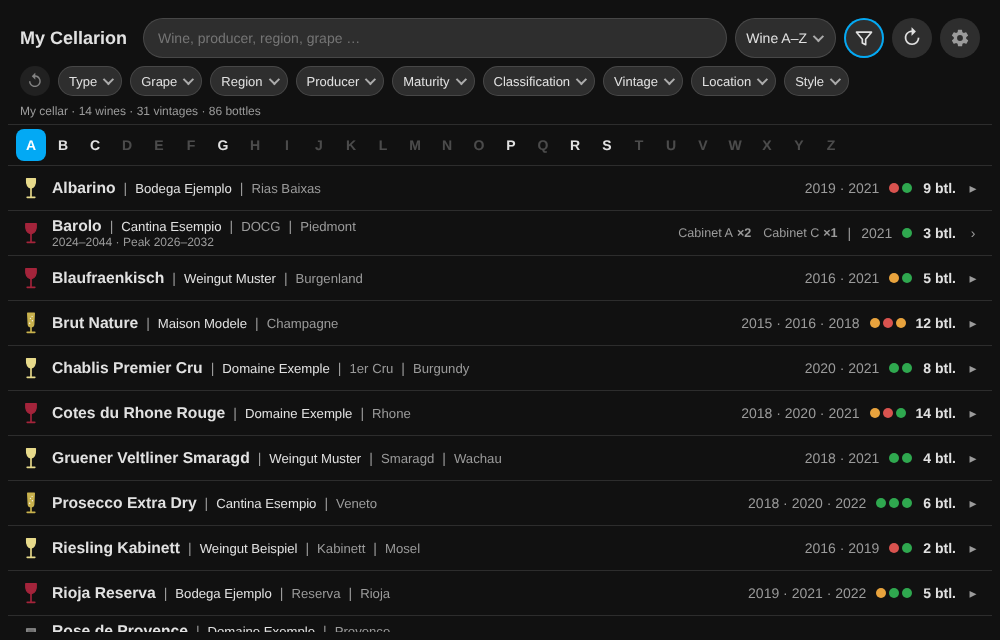
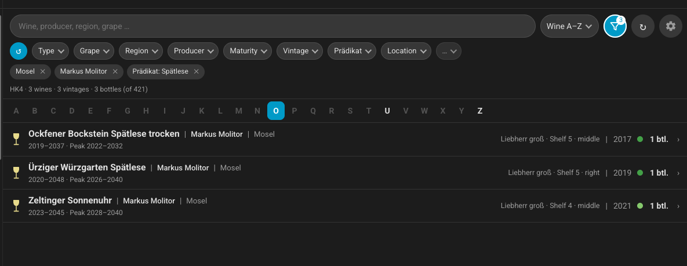
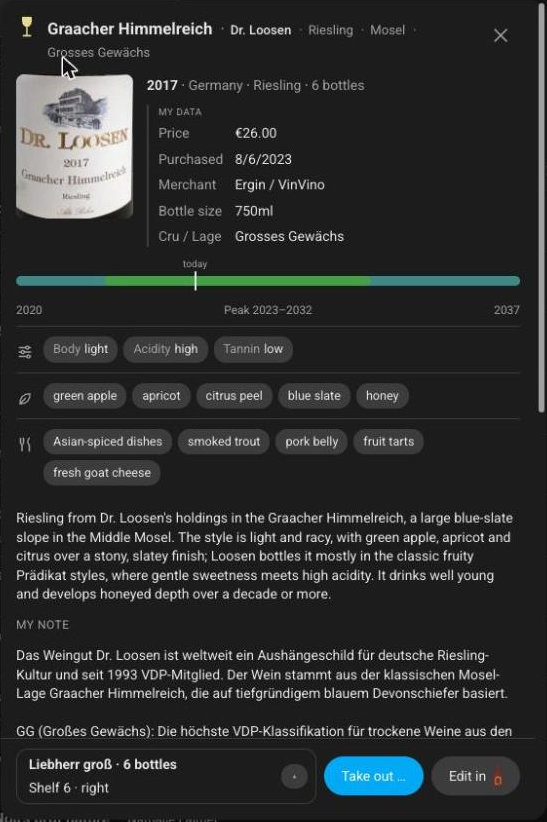
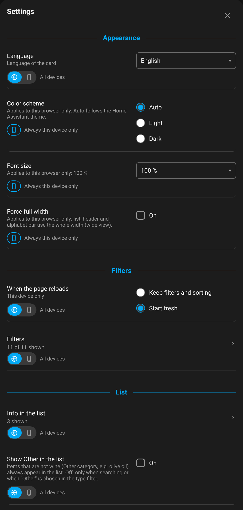
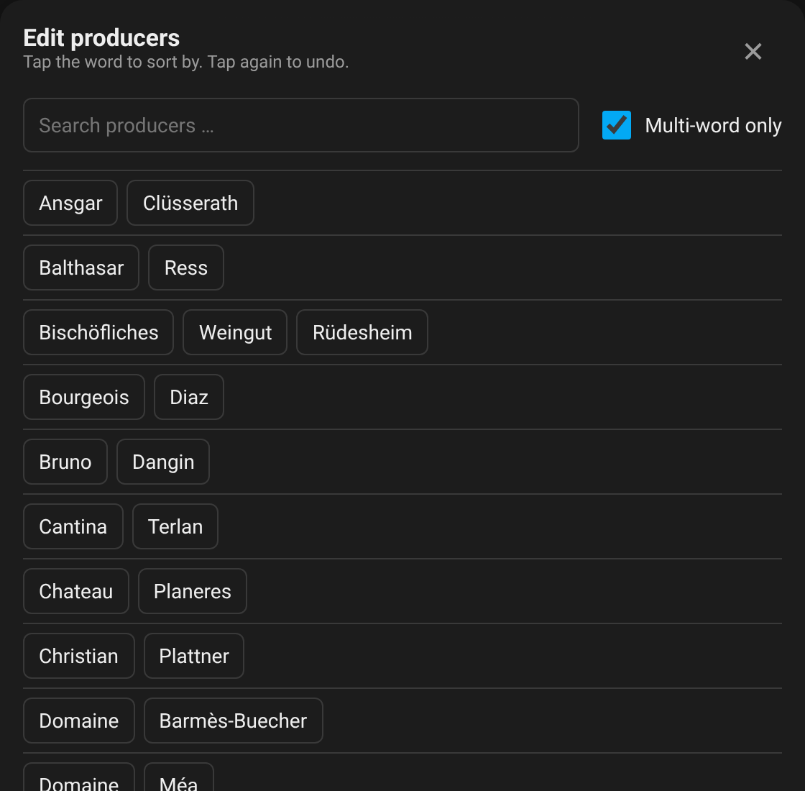
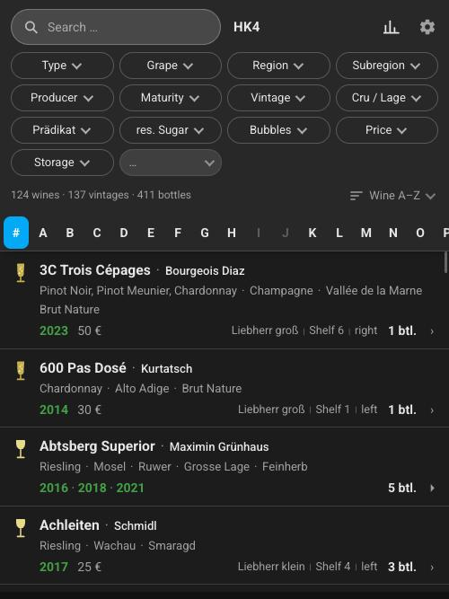

# My Cellarion

A Home Assistant dashboard card and the data integration behind it for [Cellarion](https://cellarion.app):
a searchable, filterable view of your cellar with bottle details, storage places and taking a bottle out.

> Status: early version, in use on a single setup.
>
> **Heads-up:** this project was built entirely by vibe coding with Claude (Anthropic). If that is not your thing, please don't install it.

<p align="center">
  <br>
  <br>
  
  
  
  
</p>

*Desktop/tablet layout; the last picture shows the phone layout.*

## What you get

- **Inventory** grouped by wine with search, A–Z index and filters (type, grape, region, producer, maturity, vintage, rack
  and every personal data field you keep in Cellarion).
- **Bottle details**: your own data (price, purchase, notes), the register profile (body, acidity, flavours, food pairings),
  drink window, label image, storage places with count per place, **take out** from a fixed bar.
- **Per-rack display settings** in the card: count shelves from top or bottom, show left/middle/right or slot number.
- Languages: English and German (add a language by dropping a JSON file into `www/cellarion-i18n/`).
  Language and filter settings can be shared by all devices or kept per device.
- Colours follow your Home Assistant theme and can be overridden with `--cellarion-*` variables.

It complements the official [ha-cellarion](https://github.com/jagduvi1/ha-cellarion) integration (sensors, statistics,
"ready to drink" card); both can run side by side. This one is independent and uses its own API token.

## Requirements

Cellarion **v1.275 or newer** (cellarion.app is always current). The inventory is read with a single request to `GET /api/inventory`,
and an unchanged inventory answers `304`, so keeping the card up to date costs almost nothing. Older self-hosted servers do not have that endpoint.

## Install

1. HACS → Integrations → ⋮ → Custom repositories → `https://github.com/d3rb3rt/my-cellarion-ha`, category **Integration**.
2. Install, restart Home Assistant.
3. In Cellarion create an API token (Settings → API tokens) with scope **read**, plus **consume** to take bottles out.
4. Settings → Devices & services → Add integration → **My Cellarion**, enter the address and the token. If your account has several cellars you choose one (changeable later under **Configure**).
5. The card is registered automatically. Add **My Cellarion** to a dashboard (or `type: custom:my-cellarion-card`).

## Settings

Tap the gear in the card. Choices marked with the globe/phone switch can be shared by all devices or kept on this device only.

- **Language:** automatic (language of the Home Assistant user), English or German.
- **Filters:** which filters are shown and in which order (your own Cellarion data fields appear as filters too).
- **Edit producers:** pick the word a producer is sorted by (for example "Haag" for "Fritz Haag"); drives the A–Z index.
- **Storage locations, per rack:** count shelves from the top or from the bottom, and show the position as left/middle/right, as a slot number, or not at all.
- **Font size:** zoom from 85 % to 200 %, remembered per browser.

In Home Assistant, under the integration's **Configure**: refresh interval of the background update and, if your account has several cellars, which one is shown.

## Card options (all optional)

```yaml
type: custom:my-cellarion-card
title: My Cellarion   # default: the cellar name
language: de          # default: language of the Home Assistant user
```

More options are listed at the top of `custom_components/my_cellarion/www/my-cellarion-card.js`.

## Services

`my_cellarion.read`, `refresh`, `sync`, `bottle`, `settings`, `producer_sort`, `consume_bottle` (used by the card, `consume_bottle`
is also handy for automations).

## Privacy

Only your own Cellarion server (or cellarion.app) is contacted. Label images are cached in `<config>/my_cellarion_img`
and served without login to the browser, like other files in `www`.

## Development

The card is developed in a separate Home Assistant setup and copied here with `tools/sync_card.sh <path to www>`.
Tests: `pip install pytest-homeassistant-custom-component && pytest`.
